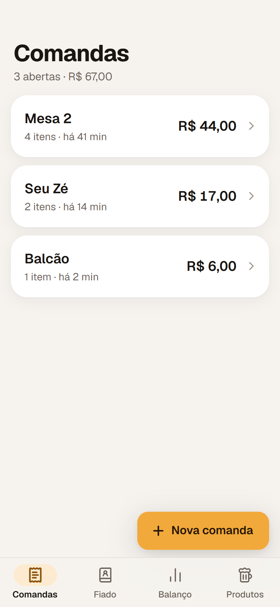
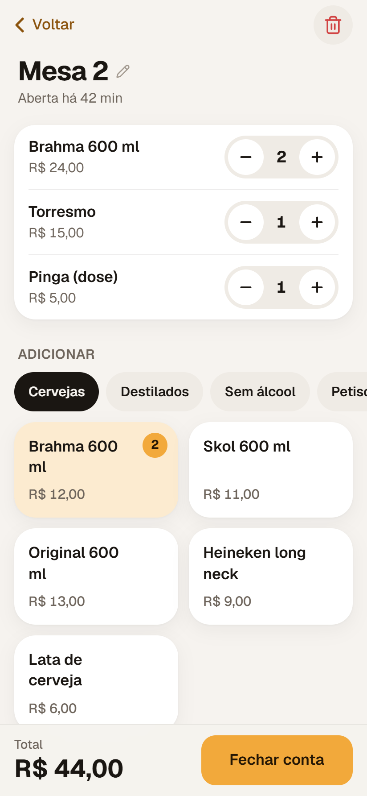
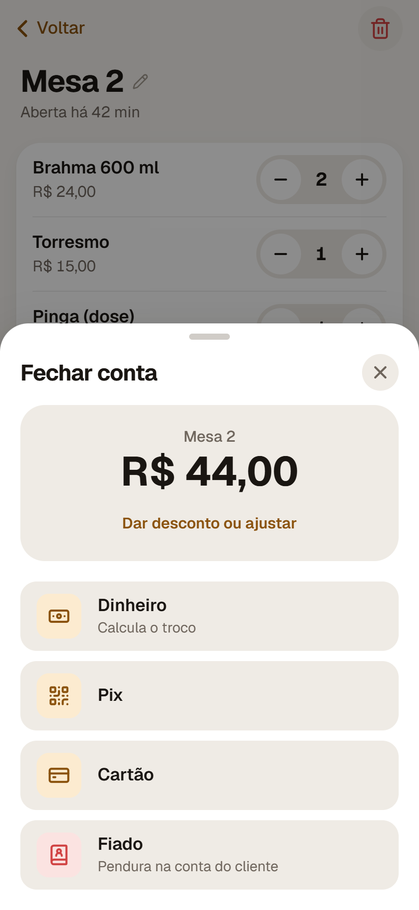
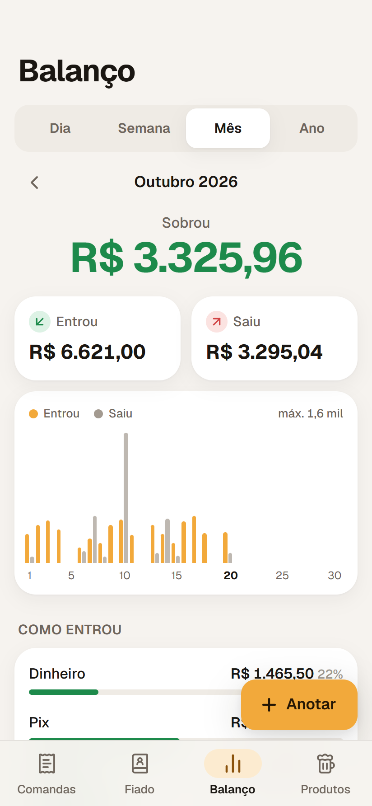
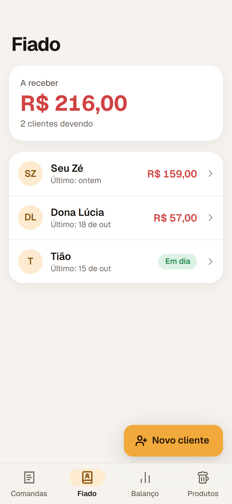
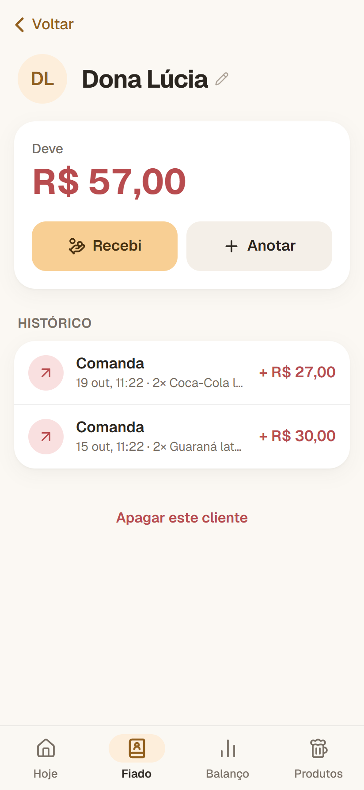
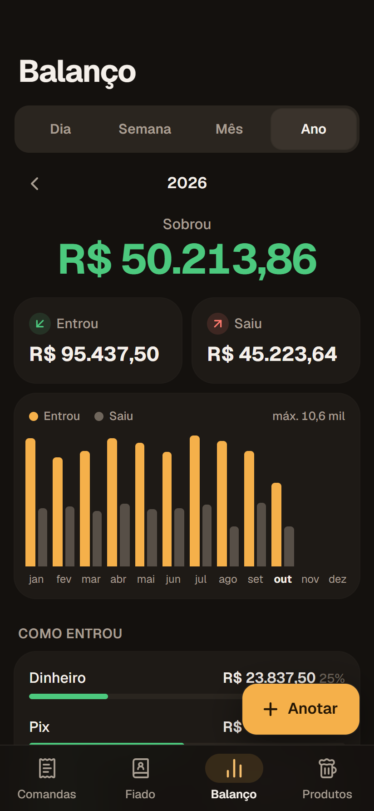
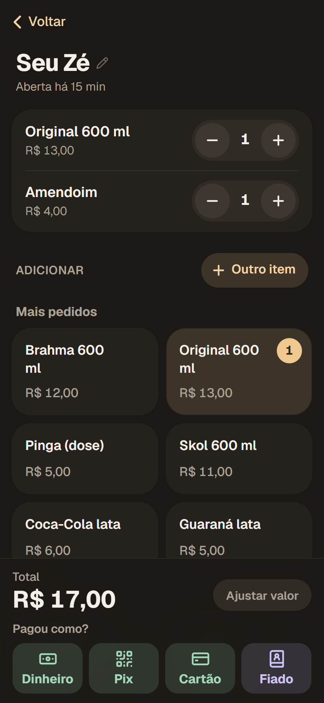

<div align="center">


# Komicho Bar

**Comandas, fiado e balanço do boteco na palma da mão.**

App instalável (PWA) feito para o dia a dia de um bar de vila: abre comanda num toque, pendura no fiado e mostra quanto entrou, saiu e sobrou no dia, na semana, no mês e no ano.

<br />

[](https://komicho-bar.vercel.app)

<sub>Uso interno do Komicho Bar: só a conta Google do dono entra.</sub>

<br />


</div>

<br />

## Sobre o projeto

Todo boteco pequeno tem o mesmo caderno: a comanda anotada no guardanapo, o fiado do cliente fiel numa página rabiscada e, no fim do mês, a dúvida de sempre: **sobrou dinheiro ou não?**

O Komicho Bar troca esse caderno por um app que qualquer pessoa da família consegue usar. Abrir uma comanda é digitar o nome do freguês. Somar uma cerveja é tocar no botão da cerveja. Fechar a conta é escolher Dinheiro, Pix, Cartão ou Fiado, e o app faz o resto: calcula o troco, pendura na conta do cliente ou lança a venda no Balanço sozinho.

O diferencial está no acabamento. O visual segue o padrão dos melhores apps nativos (Apple e Google): painéis que sobem de baixo com efeito de mola, título grande que encolhe ao rolar, vibração leve ao tocar, modo escuro pensado para a noite no bar e botões grandes, porque quem usa está atrás do balcão, com pressa. Tudo que apaga tem "Desfazer", e o app abre mesmo sem internet.

<br />

## Telas

<div align="center">

<table>
  <tr>
    <td align="center"><br /><sub><b>Comandas</b> · o que está aberto agora</sub></td>
    <td align="center"><br /><sub><b>Comanda</b> · um toque soma o item</sub></td>
    <td align="center"><br /><sub><b>Fechar conta</b> · dinheiro, Pix, cartão ou fiado</sub></td>
  </tr>
  <tr>
    <td align="center"><br /><sub><b>Balanço</b> · entrou, saiu e sobrou</sub></td>
    <td align="center"><br /><sub><b>Fiado</b> · quanto há para receber</sub></td>
    <td align="center"><br /><sub><b>Cliente</b> · saldo e histórico</sub></td>
  </tr>
  <tr>
    <td align="center"><br /><sub><b>Modo escuro</b> · balanço do ano</sub></td>
    <td align="center"><br /><sub><b>Modo escuro</b> · comanda aberta</sub></td>
    <td></td>
  </tr>
</table>

<sub>Prints do modo demonstração, com dados fictícios.</sub>

</div>

<br />

## Funcionalidades

- 🍺 **Comandas** no nome do freguês, com aviso se já houver uma aberta para a mesma pessoa
- ➕ **Grade de produtos** por categoria: cada toque soma 1, com contador no botão e ajuste de − / +
- 💵 **Fechar conta** em Dinheiro (com cálculo de troco), Pix, Cartão ou Fiado, com desconto opcional
- 📒 **Fiado**: saldo de cada cliente, histórico com os itens de cada comanda, receber pagamento (total ou parcial) e anotar valor avulso
- 📊 **Balanço** por dia, semana, mês e ano: entrou, saiu e sobrou, gráfico de barras (toque numa barra para abrir o dia ou o mês), entradas por forma de pagamento e gastos por categoria
- ✍️ **Anotar** gastos (Bebidas, Gelo e carvão, Petiscos, Luz e água, Aluguel, Outros) e vendas sem comanda, com data
- 🧾 **Cardápio** editável, com preço guardado no momento da venda (mudar o preço não altera vendas antigas)
- ↩️ **Desfazer** em tudo que apaga ou fecha
- 🌙 **Tema claro, escuro ou automático**
- 📲 **Instalável** no Android e no iPhone, abre sem internet e avisa quando há versão nova
- 🔒 **Login só com Google**, liberado apenas para a conta do dono (app e regras do banco)

<br />

## Tecnologias

| Camada | Stack |
|---|---|
| Interface | React 19 · TypeScript · Tailwind CSS v4 · Motion (animações) · Lucide (ícones) · fonte Geist |
| Navegação | React Router 7 |
| App instalável | vite-plugin-pwa (Workbox) · ícones gerados com @vite-pwa/assets-generator |
| Dados | Firebase Firestore com cache offline persistente · modo demo com localStorage |
| Login | Firebase Auth, só Google e só o e-mail do dono |
| Build | Vite 8 (Rolldown) |
| Hospedagem | Vercel (deploy automático a cada push na `main`) |

<br />

## Arquitetura

```
komicho-bar/
├── brand/                  # ícone usado no README
├── docs/                   # arquitetura, padrões, deploy, manual de uso e prints
├── public/                 # favicon e ícones do PWA (gerados por `npm run icones`)
├── src/
│   ├── components/         # blocos de interface (ui, Sheet, Cabecalho, Layout...)
│   ├── context/            # Dados, Auth, Tema e Avisos (estado global)
│   ├── hooks/              # useVoltar, useInstalar
│   ├── lib/                # repo (Firestore/localStorage), balanco, datas, dinheiro, seed
│   ├── pages/              # uma tela por arquivo (Comandas, Balanco, Fiado...)
│   ├── types.ts            # modelo de dados (valores sempre em centavos)
│   └── App.tsx             # provedores e rotas
├── firestore.rules         # só e-mails autorizados leem e gravam
└── vite.config.ts          # PWA, manifesto e divisão do bundle
```

O mesmo repositório genérico grava no **Firestore** quando o Firebase está configurado e no **localStorage** quando não está, então as telas não sabem (nem precisam saber) onde os dados moram. Fechar uma conta é uma gravação única e atômica:

```ts
// Fecha a conta: vira entrada no Balanço ou conta no fiado, e a comanda some.
gravarJuntos([registro, { tipo: "remove", colecao: "comandas", id: c.id }]);
```

E as regras do Firestore liberam o banco só para as contas autorizadas:

```js
function autorizado() {
  return request.auth != null
    && request.auth.token.email_verified == true
    && request.auth.token.email in ['danyy.jonathan@gmail.com'];
}
```

Detalhes em [`docs/arquitetura.md`](docs/arquitetura.md).

<br />

## Como rodar localmente

1. Instale as dependências:
   ```bash
   npm install
   ```
2. Rode em **modo demonstração** (dados fictícios, sem login):
   ```bash
   npm run dev:demo
   ```
3. Ou rode o **app real** (Firebase, login com Google):
   ```bash
   npm run dev
   ```
4. Configuração do Firebase e da Vercel em [`docs/deploy.md`](docs/deploy.md).
5. Build de produção:
   ```bash
   npm run build
   ```

<br />

## Roadmap

- [x] Comandas, fechar conta com troco e desconto
- [x] Fiado com histórico e pagamento parcial
- [x] Balanço por dia, semana, mês e ano com gráfico
- [x] Tema claro/escuro, PWA instalável e offline
- [x] Projeto Firebase e app web configurados
- [x] Firestore, login Google e regras de segurança no ar
- [x] Publicado na Vercel ([komicho-bar.vercel.app](https://komicho-bar.vercel.app))
- [ ] Cadastrar o cardápio real do bar
- [ ] Acesso da segunda pessoa (celular da mãe)
- [ ] Exportar o balanço do mês (PDF ou planilha)
- [ ] Produtos mais vendidos no Balanço

<br />

## Autor

Feito por **Dany Jonathan Bueno** — estudante de Análise e Desenvolvimento de Sistemas e desenvolvedor em formação.

[](https://www.linkedin.com/in/danyyjonathan)
[](https://www.instagram.com/danyyjonathan)
[](https://mail.google.com/mail/?view=cm&fs=1&to=danyy.jonathan@gmail.com)

<br />

<div align="center">
<sub>Komicho Bar · feito com cuidado para o balcão de um bar de vila.</sub>
</div>
